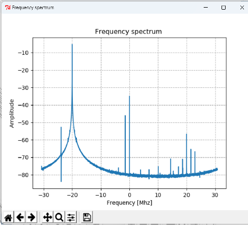
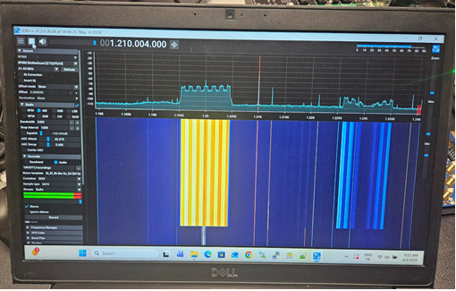

.. sectnum::

**IQ Player — porting guide for LimeSDR-Micro on NXP Platform (i.MX or Layerscape)** 
++++++++++++++++++++++++++++++++++++++++++++++++++++++++++++++++++++++++++++++++++++

Overview
********

This guide describes how to add support for LA9310 IQ Player and the LimeSDR-Micro M.2 board (LA9310 + LMS7002M)
on NXP platforms such as FRDM-IMX8MPLUS, FRDM-IMX95, LS1043ARDB, LS1046ARDB, LX2160ARDB and HoneyComb LX2.
It replaces the LimeSuiteNG stock radio stack with IQ Player.

The LA9310 can run several software stacks. They use different M4 / VSPA firmware and host
software and cannot run at the same time:

.. list-table::
   :header-rows: 1
   :widths: 18 27 25 30

   * - Stack
     - LA9310 firmware (M4 / VSPA)
     - Host side
     - Use it for
   * - Stock LimeSDR-Micro
     - Lime firmware
     - LimeSuiteNG
     - Lime tools and SDR applications that need timestamped streaming
   * - Stock RFNM
     - RFNM ``la9310-freertos`` / RFNM VSPA
     - ``la9310rfnm``, librfnm, SoapySDR / GNU Radio
     - RFNM applications (RFNM board only)
   * - IQ Player (this repository)
     - NXP or patched RFNM M4 / IQ Player VSPA
     - ``iq_app``, ``libiqplayer``, host-utils
     - raw time-domain I/Q capture and replay, open VSPA source, starting point for new
       platforms
   * - fr1_fr2_test_tool (DFE)
     - NXP ``la93xx_freertos`` (DFE) / 5G DFE VSPA
     - DPDK ``dfe_app``
     - 5G low PHY in the VSPA (symbol sync, cyclic prefix, FFT / iFFT); the host exchanges
       frequency-domain samples. FDD on LimeSDR-Micro, TDD on RFNM only

This guide covers IQ Player and fr1_fr2_test_tool on LimeSDR-Micro. IQ Player on RFNM is
described in ``iqplayer_porting_guide_RFNM-SDK.rst``.

Hardware Requirements
*********************

FRDM-IMX8MPLUS or FRDM-IMX95 

- refer to https://www.nxp.com/design/design-center/development-boards-and-designs/frdm-development-boards:FRDM

Layerscape LS1043ARDB, LS1046ARDB, LX2160ARDB, HoneyComb LX2

- refer to https://www.nxp.com/design/design-center/development-boards-and-designs/LS1043A-RDB
- refer to https://www.nxp.com/design/design-center/development-boards-and-designs/LS1046A-RDB
- refer to https://www.nxp.com/design/design-center/software/qoriq-developer-resources/layerscape-lx2160a-reference-design-board:LX2160A-RDB
- refer to https://www.solid-run.com/arm-servers-networking-platforms/honeycomb-lx2/

limesdr-micro M.2 board (or miniPCI)

- refer to https://www.crowdsupply.com/lime-micro/limesdr-micro 

Hardware Setup
**************

LimeSDR-Micro
 .. image:: pictures/LimeSDR-Micro-board.jpg

imx95-frdm
 .. image:: pictures/imx95-frdm_LimeSDR-Micro-board.png

imx8mp-frdm
 .. image:: pictures/imx8mp-frdm_LimeSDR-Micro-board.png

LimeSDR-Micro official software environment
*******************************************

Lime Microsystems provides an official, productized software framework supporting various SDR ecosystems such as plug-ins for SoapySDR, GNU Radio, Amarisoft 4G/5G, and others. 
There is also support for OpenAirInterface and srsRAN Project.

References:

- https://myriadrf.org/projects/limesdr-micro/ 
- https://github.com/myriadrf/LimeSuiteNG/tree/limesdr-micro

The LimeSDR-Micro software is derived from basic NXP LA9310 drivers, applications and firmwares, in particular IQ Player. 
This porting guide uses the LimeSDR-Micro module as a reference to explain how to:

- Deploy NXP linux BSP
- Enable IQ Player : Basic time domain capture/replay firmware The LA9310 "Hello-world" app.
- Enable FR1FR2TestTool/DFE_app : 5G DFE and low PHY firmware for LA9310  

This porting guide will help users to enable LA9310 and new platforms.

Linux BSP images for i.MX or Layerscape boards
**********************************************

The starting point is the standard NXP Linux BSP for i.MX and Layerscape processors ( https://www.nxp.com/linux )

NXP Debian Linux BSP
https://www.nxp.com/design/design-center/software/embedded-software/linux-software-and-development-tools/nxp-debian-linux-sdk-distribution-for-i-mx-and-layerscape:NXPDEBIAN

NXP Yocto BSP
https://www.nxp.com/design/design-center/software/embedded-software/i-mx-software/embedded-linux-for-i-mx-applications-processors:IMXLINUX

Debian Linux BSP is recommended, it is easier to enable various SDR framework allowing simple "apt install" of necessary packages.
Refer to the BSP user guide for instructions on building and deploying images for the selected target.

Example for Debian
..................

::

 git clone https://github.com/NXP/flexbuild.git
 cd flexbuild
 . setup.env  (in host environment)
 bld docker   (create or attach to docker)
 . setup.env  (in docker environment)
 bld host-dep (install host dependent packages)

 bld -m imx8mpfrdm
 bld -m imx95frdm
 bld -m ls1046ardb
 bld -m lx2160ardb  

Deployment sdcard using flex-installer on a laptop
~~~~~~~~~~~~~~~~~~~~~~~~~~~~~~~~~~~~~~~~~~~~~~~~~~

user can deploy images on sdcard directly from compilation host machine
::

  [root@fbdebian flexbuild-lf-6.6.52-2.2.0]$ ls build_lsdk2506/images/flex-installer
  $ flex-installer -r rootfs_lsdk_debian_xx_arm64.tar.zst -d /dev/sdx         (only install rootfs partition image)
  $ flex-installer -b boot_IMX_arm64_lts_xx.tar.zst -d /dev/sdx -m <machine>  (only install boot partition image)
  $ flex-installer -f firmware_<machine>_sdboot.img -d /dev/sdx -m <machine>  (only install composite firmware image)
  machine = imx8mpfrdm, imx95frdm, ls1046ardb, lx2160ardb

Deployment sdcard using flex-installer on the target
~~~~~~~~~~~~~~~~~~~~~~~~~~~~~~~~~~~~~~~~~~~~~~~~~~~~

start linux tinyDistro on the target from u-boot
::

 u-boot=> tftp lsdk2512_poky_tiny_IMX_arm64.itb
 u-boot=> bootm 0x90400000#imx95frdm
 u-boot=> bootm 0x40400000#imx8mpfrdm

copy images into ramfs /var/volatile or nfs mount location (solve size limitations)

nfs mount
::

 mkdir /mnt/nfs/
 root@TinyLinux:# busybox mount -o port=2049,nolock,proto=tcp -t nfs <serverip>:/tftpboot/ /mnt/nfs/

Deploy images
::

 root@TinyLinux:/mnt/nfs# flex-installer -f firmware_imx8mpfrdm_sdboot.img -d /dev/mmcblk1 -m imx8mpfrdm
 root@TinyLinux:/mnt/nfs# flex-installer -b boot_IMX_arm64_lts_6.12.20.tar.zst -r rootfs_lsdk2512_debian_imx8mpfrdm.tar.zst -d /dev/mmcblk1 -m imx8mpfrdm

Add LA9310 support 
******************

To enable LA9310 support, the following software components must be modified or added:

- Linux kernel : Add patches for LA9310 support (PCI quirks, memory reservation in the device tree)

- la93xx_host_sw : Compile and deploy the LA9310 PCI driver (shiva)

- la93xx_firmware : Compile and deploy LA9310 firmwares : FreeRTOS (dfe_app) and VSPA firmwares (IQPlayer and/or Fr1Fr2TestTool)

- dpdk-dfe-app : Compile and deploy linux dfe application providing basic CLI to control the LA9310 e200 firmwares and the RF chain

Tool chains
...........

ARMv8 tool chain 
~~~~~~~~~~~~~~~~
::

   sudo apt-get install -y build-essential libncurses-dev bison flex libssl-dev libelf-dev zlib1g-dev bc
   sudo apt-get install gcc-aarch64-linux-gnu

e200 tool chain 
~~~~~~~~~~~~~~~~
::

   download and install gcc-arm-none-eabi-6-2017-q2-update-linux.tar.bz2
   wget https://www.nxp.com/lgfiles/geul/Tools/gcc-4.9.4-Ee200-eabivlex86_64-linux-g2724867.tar.bz2

VSPA tool chain
~~~~~~~~~~~~~~~

Download
::

   VSPA2/LA9310 : wget https://www.nxp.com/lgfiles/sdk/la1224/imx-la9310-sdk-10/cwvspa.vbeta_14_00_781_vspa.linux.tgz
   VSPA3/LA1224 : wget https://www.nxp.com/lgfiles/sdk/la12xx_sdk3.2_revc_ext/cwvspa.valpha3_00_00_432_vspa.linux.tgz

Install  
::

 tar -xvf cwvspa.vbeta_14_00_781_vspa.linux.tgz
 sudo mv VSPA_Tools/ /opt/VSPA_Tools_vbeta_14_00_781

Compiler is 32bit executable, need to add 32bit support to avoid following errors
/opt/VSPA_Tools_vbeta_14_00_781/bin/fsvspacc: No such file or directory
libstdc++.so.6: cannot open shared object file: No such file or directory
::

   sudo apt install libc6:i386 lib32stdc++6

Linux Kernel 
............

clone linux source code 
~~~~~~~~~~~~~~~~~~~~~~~

NXP provides a specific kernel branch with necessary patches to support LA9310 and LA12xx devices.
User has choice to use this branch or port the commits listed below onto their kernel tree

::

 git clone https://github.com/nxp-qoriq/linux/ -b la12xx-linux-6.12-rt
 cd linux

Relevant commits
~~~~~~~~~~~~~~~~

  - f49a00ec7bea arm64: imx_v8_defconfig: add SCTP config by default
  - f92b307c3e4e arm64: imx_v8_defconfig disable CONFIG_STRICT_DEVMEM
  - 7d7f2f5fe9bf Fix i.mx8mp/dxl board selection for pci config
  - 80fe046ac541 5g-linux: fix imx8dxl pci bar configuration
  - 445ee98f4a75 Configure the LA9310 BAR 0 to 64MB due to limited size of PCIe region on i.mx8dxl & i.mx8mp
  - ae33a1d15a68 fix "make bindeb-pkg" use to generate kernel headers debian package
  - 81f6a95cf0f3 arm64: dts: imx95: Increase the outbound space size to 2G bytes

Compile Linux Kernel and Device Tree
~~~~~~~~~~~~~~~~~~~~~~~~~~~~~~~~~~~~

For i.MX
::

 export CROSS_COMPILE=aarch64-linux-gnu-
 export ARCH=arm64
 make imx_v8_defconfig
 make -j$(nproc)

For Layerscape
::

 export CROSS_COMPILE=aarch64-linux-gnu-
 export ARCH=arm64
 ./scripts/kconfig/merge_config.sh arch/arm64/configs/defconfig arch/arm64/configs/lsdk.config
 make -j$(nproc)

Deploy Linux Image
~~~~~~~~~~~~~~~~~~

Replace kernel image and device tree on the target :
::

  arch/arm64/boot/dts/freescale/imx95-15x15-frdm.dtb
  arch/arm64/boot/dts/freescale/imx8mp-frdm.dtb 
  arch/arm64/boot/Image 

  root@frdm:~# ls /boot/
  Image  imx95-15x15-frdm.dtb imx8mp-frdm.dtb   

prepare kernel modules
::

  mkdir modules_install
  make INSTALL_MOD_PATH=./modules_install modules_install
  cd modules_install
  tar -czvf modules.tar.gz lib

Copy modules.tar.gz to the target and extract and install under /lib/modules/

Deploy Kernel headers to kernel module native compilation 
~~~~~~~~~~~~~~~~~~~~~~~~~~~~~~~~~~~~~~~~~~~~~~~~~~~~~~~~~

prepare kernel headers
::

  make bindeb-pkg

deploy kernel headers on the target
::

  dpkg -i linux-headers-6.12.34-rt11-xxx_arm64.deb

la93xx_host_sw
..............

clone la93xx_host_sw linux kernel module source code  
~~~~~~~~~~~~~~~~~~~~~~~~~~~~~~~~~~~~~~~~~~~~~~~~~~~~
::

 git clone  https://github.com/nxp-qoriq/la93xx_host_sw.git
 cd la93xx_host_sw

Recompile the shiva driver against the newly built kernel
~~~~~~~~~~~~~~~~~~~~~~~~~~~~~~~~~~~~~~~~~~~~~~~~~~~~~~~~~

::

 cd la93xx_host_sw
 git submodule update --init

 export KERNEL_DIR=$PWD/../linux
 export LA9310_COMMON_HEADERS=$PWD/../la93xx_freertos/common_headers
 export LA9310_DRV_HEADER_DIR=$PWD/../la93xx_host_sw/kernel_driver/la9310sdr
 export CROSS_COMPILE=aarch64-linux-gnu-
 export ARCH=arm64
 make clean
 CONFIG_ENABLE_FLOAT_BYPASS=y make

.. note::

   dependency : need to clone FreeRTOS to get common_headers

Deploy images
::

 make install
 scp -r install/* root@<targetIP>:/

copy la9310shiva.ko to:
::

 cp /kernel_module/* /lib/modules/$(uname -r)/extra/  

la93xx_firmware (LA9310 FreeRTOS)
.................................

Dependency : need to clone LimeSuiteNG first
~~~~~~~~~~~~~~~~~~~~~~~~~~~~~~~~~~~~~~~~~~~~
::

 git clone https://github.com/myriadrf/LimeSuiteNG.git
 git checkout -b limesdr-micro origin/limesdr-micro

clone FreeRTOS source code 
~~~~~~~~~~~~~~~~~~~~~~~~~~
::

 git clone https://github.com/nxp-qoriq/la93xx_freertos.git
 cd la93xx_freertos/

Compile FreeRTOS with LimeSDR-micro support 
~~~~~~~~~~~~~~~~~~~~~~~~~~~~~~~~~~~~~~~~~~~~
::

 export ARMGCC_DIR=/opt/gcc-arm-none-eabi-6-2017-q2-update
 export LA9310_HOST_SW_UAPI=$PWD/../la93xx_host_sw/uapi
  cd Demo/CORTEX_M4_NXP_LA9310_GCC
 ./clean.sh 
 ./build_release.sh -m pcie -t lime_sdr_micro -f LA9310_DFE_APP=ON -b release

Default LA9310_SYS_CLK_FREQ is 61.44Mhz, can be changed up to 160Mhz here
::

 Demo/CORTEX_M4_NXP_LA9310_GCC/CMakeLists.txt : SET(LA9310_SYS_CLK_FREQ "61440000" CACHE STRING "LA9310 post init system clock frequency")

Deploy FreeRTOS Image
~~~~~~~~~~~~~~~~~~~~~
::

 scp release/la9310.bin  root@<target IP>:/lib/firmware/la9310_dfe.bin

dpdk dfe_app Lime CLI
.....................

clone dpdk source code 
~~~~~~~~~~~~~~~~~~~~~~

::

 git clone https://github.com/NXP/dpdk -b 25.11-qoriq
 cd dpdk 

Compile dpdk dfe_app
~~~~~~~~~~~~~~~~~~~~

::

 export LA9310_COMMON_HEADERS=$(realpath $PWD/../la93xx_freertos/common_headers)
 export LA9310_HOST_SW_UAPI=$(realpath $PWD/../la93xx_host_sw/uapi)
 meson arm64-build --cross-file config/arm/arm64_dpaa_linux_gcc -Dbuildtype=debug -Dexamples=dfe_app
 ninja -C arm64-build

install dpdk
~~~~~~~~~~~~

::

 scp ./arm64-build/examples/dpdk-dfe_app  root@<target IP>:/usr/local/bin/

IQ Player
.........

Compile and deploy iqplayer firmware and utilities

Default VSPA tools path:
::

 VSPA_TOOL ?= /opt/VSPA_Tools_vbeta_14_00_781

IQ Player has two external header dependencies, taken from the NXP GitHub repositories
cloned above: ``LA9310_COMMON_HEADERS`` (``la93xx_freertos/common_headers``,
``la9310_host_if.h``) and ``UAPI_DIR`` (``la93xx_host_sw/uapi``, ``la9310_modinfo.h``).
The defaults expect both trees next to ``la931x_iqplayer``; otherwise pass them explicitly.

clone and compile IQPlayer
::

 git clone https://github.com/nxp-qoriq/la931x_iqplayer.git
 cd la931x_iqplayer
 export LA9310_COMMON_HEADERS=$PWD/../la93xx_freertos/common_headers
 export UAPI_DIR=$PWD/../la93xx_host_sw/uapi
 make
 make install
 scp -r install/* root@<targetIP>:/

Testing IQ Player playing and capturing time domain waveform
............................................................

load and start VSPA firmware
::

 ./load-la9310.sh

configure LimeRF using dfe_app. On NXP platforms the RF chain is controlled by the M4
firmware through ``dpdk-dfe_app`` (on RFNM it is configured by Linux sysfs instead, see
``iqplayer_porting_guide_RFNM-SDK.rst``)
::

  echo 100 > /sys/kernel/mm/hugepages/hugepages-2048kB/nr_hugepages
  dpdk-dfe_app
  DFE> lime tx 1 freq 1200000000
  DFE> lime rx 1 freq 1210000000
  DFE> quit

optional: AXIQ digital loopback (TX looped back to RX inside the LA9310, no RF)
::

  dpdk-dfe_app -c "axiq_lb enable"
 

play (repeat) waveform from file
::

 ./iq-replay.sh ./tone_td_3p072Mhz_20ms_4KB1200_2c.bin 1200

capture (one time) iq samples into file
::

 ./rx-chan.sh 3
 ./iq-capture.sh ./iqdata.bin 1200

capture (repeat) in DDR buffer
::

 ./rx-chan.sh 3
 ./iq-capture-ddr.sh 1200
 ./iq-stop.sh

Check LA9310 freeRTOS console
::

  cat /sys/devices/platform/soc@0/33800000.pcie/pci0000:00/0000:00:00.0/0000:01:00.0/la9310sysfs/target_log

display received spectrum (on a PC, after copying iqdata.bin)
::

  python compute_tone_params.py -f 61440000 -i ./iqdata.bin

Streaming with iq_app (spectrum, QEC, snapshot)
::

  ./iq-app-tx.sh -T                     # interactive tone and TX QEC
  ./iq-app-rx.sh -X                     # live RX spectrum and RX QEC, key w = IQ snapshot
  ./iq-app-rx.sh -D ./rx.bin 4915200    # capture to rx_ch<N>.bin
  ./iq-stop.sh

Saved QEC files (key ``s``) in ``<script dir>/qec`` are applied at start. Firmware variants,
script options and QEC details are described in ``iqplayer_reference_manual.rst``.

Testing FR1FR2TestTool playing and capturing 5G waveform
........................................................

IQ Player streams raw time-domain I/Q samples. LimeSuiteNG adds features such as timestamping,
required by some SDR use cases. NXP also provides a firmware for OFDM processing, a 5G low PHY
also called DFE, used by ``fr1_fr2_test_tool``: the VSPA does 5G symbol synchronization and
delineation, cyclic prefix insertion / removal and FFT / iFFT, and exchanges frequency-domain
samples with the host. The VSPA implements the L1 low PHY; the host implements the high PHY and
the upper layers.

clone Fr1FR2Tool  
:: 

 git clone https://github.com/nxp-qoriq/fr1_fr2_test_tool
 cd fr1_fr2_test_tool

booting up firmware for LA9310
::

 ./boot_vspa.sh MEvspa_images_LS.1T2R_10M_15K_61_61_TDDFDD_LA93  

start playing test_vectors/TM3.3_10MHz_15kHz_FDD.bin
::

  ln -s /usr/local/bin/dpdk-dfe_app /usr/bin/dpdk-dfe_app
  ./channels_start.sh

configure lime
::

  root@imx8mpfrdm:~/fr1_fr2_test_tool# dpdk-dfe_app
  DFE> lime tx 1 freq 1200000000
  DFE> lime rx 1 freq 1210000000
  DFE> quit

Capture time domain waveform ( QEC disabled )

The fr1_fr2_test_tool VSPA firmware source code is available at
https://github.com/nxp-qoriq/la931x_vspa_5g_dfe

Known limitation: TDD is not supported on LimeSDR-Micro (FDD only). TDD is supported on the
RFNM board only.

Tips 
****

Unexpected imx95frdm going to sleep
...................................

::

 root@imx95frdm:~/host_utils# [  916.073426] fsl_enetc4 0001:00:00.0 eth0: Link is Down
 [  916.419685] PM: suspend entry (deep)
 [  916.437359] Filesystems sync: 0.014 seconds
 [  916.445646] Freezing user space processes

To disable suspend on a Linux system, you can use the command: 
:: 

 sudo systemctl mask sleep.target suspend.target hibernate.target hybrid-sleep.target. 
 
After running this command, reboot your system to apply the changes.

If needed enable LA9310 EP BAR0-2 [disabled] 
............................................

user need to ensure la9310 BAR0-2 are enabled before issuing ./load-la9310.sh

::

 root@imx95frdm:# lspci |grep 1c12
 0000:01:00.0 Unclassified device [0002]: Freescale Semiconductor Inc Device 1c12 (rev 10) (prog-if 80)

 root@imx95frdm:~# lspci -v -s 0000:01:00.0
 0000:01:00.0 Unclassified device [0002]: Freescale Semiconductor Inc Device 1c12 (rev 10) (prog-if 80)
         Flags: fast devsel, IRQ 273, IOMMU group 11
         Memory at 910000000 (32-bit, non-prefetchable) [disabled] [size=256M]
         Memory at 921000000 (32-bit, non-prefetchable) [disabled] [size=128K]
         Memory at 928000000 (64-bit, prefetchable) [disabled] [size=8M]

 root@imx95frdm:~# setpci -s 01:00.0 COMMAND=0x02

 root@imx95frdm:~# lspci -v -s 0000:01:00.0
 0000:01:00.0 Unclassified device [0002]: Freescale Semiconductor Inc Device 1c12 (rev 10) (prog-if 80)
         Flags: fast devsel, IRQ 273, IOMMU group 11
         Memory at 910000000 (32-bit, non-prefetchable) [size=256M]
         Memory at 921000000 (32-bit, non-prefetchable) [size=128K]
         Memory at 928000000 (64-bit, prefetchable) [size=8M]

early IQ Player scripts expect default sh as bash shell
.......................................................

if needed replace script directive 
::

 cd ~/host_utils
 sed -i 's/\/bin\/sh/\/bin\/bash/g' *.sh

